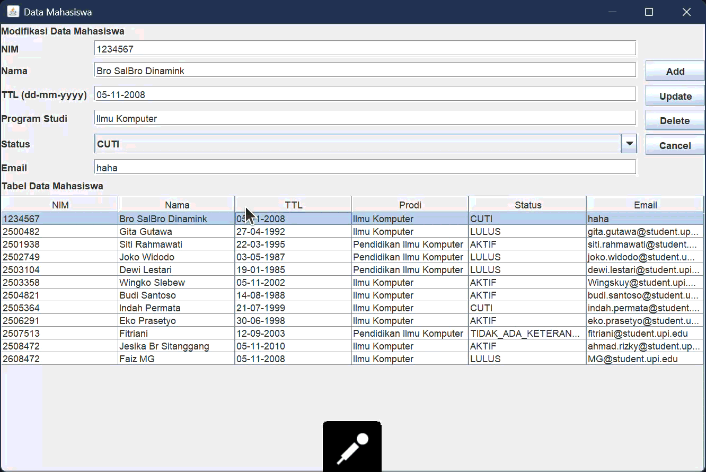

# TP5DPBO2526C1
Java Swing GUI: Database dan Back-End

# Aplikasi Pengelolaan Data Mahasiswa (Mahasigma)

Aplikasi desktop GUI berbasis **Java Swing** dengan konektivitas database **MySQL** untuk melakukan operasi CRUD (*Create, Read, Update, Delete*) pada data mahasiswa.

## 1. Desain Program

Program ini dirancang menggunakan arsitektur pemisahan tanggung jawab (*Separation of Concerns*) berbasis OOP (Object-Oriented Programming). Komponen utama pembangun program terdiri dari beberapa kelas berikut:

### **a. Struktural Kelas & Komponen**

1. **`Mahasiswa.java` (Model)**
   - Merupakan representasi entitas data Mahasiswa.
   - Mengandung atribut: `nim`, `nama`, `ttl`, `prodi`, `status`, dan `email`.
   - Menggunakan `enum StatusMahasiswa` (`AKTIF`, `CUTI`, `TIDAK_ADA_KETERANGAN`, `LULUS`) untuk menjamin validitas nilai atribut status.

2. **`Database.java` (Database Handler)**
   - Mengelola koneksi JDBC ke database MySQL (database: `tp5_mahasigma`).
   - Menyediakan fungsi modular:
     - `selectQuery(String sql)`: Menjalankan kueri `SELECT` dan mengembalikan objek `ResultSet`.
     - `insertUpdateDeleteQuery(String sql)`: Menjalankan kueri manipulasi data (`INSERT`, `UPDATE`, `DELETE`).

3. **`MahasiswaForm.java` & `MahasiswaForm.form` (UI View)**
   - Berisi komponen GUI Swing yang dirancang menggunakan GUI Designer IntelliJ IDEA.
   - Komponen meliputi: `JTextField` (input data), `JComboBox` (pilihan status), `JButton` (`Add`, `Update`, `Delete`, `Cancel`), dan `JTable` (menampilkan daftar mahasiswa).

4. **`DataMahasiswa.java` (Controller & Main Class)**
   - Mewarisi `JFrame` dan bertindak sebagai pengontrol utama logika aplikasi.
   - Menghubungkan tampilan (`MahasiswaForm`) dengan database (`Database`).
   - Mengatur event handling (listener) untuk tombol dan interaksi klik baris pada tabel.

---

## 2. Penjelasan Alur Program

Berikut adalah alur kerja dan operasional aplikasi dari awal dijalankan hingga pengolahan data:

```
[Inisialisasi Program] ──> [Muat Data ke JTable] ──> [Menunggu Interaksi User]
                                                             │
        ┌───────────────────────┬────────────────────────────┼────────────────────────┐
        ▼                       ▼                            ▼                        ▼
  [Tambah Data]           [Pilih Baris]                 [Ubah Data]              [Hapus Data]
        │                       │                            │                        │
  Validasi Form          Tampilkan Data                 Validasi Form           Konfirmasi Hapus
  & Cek NIM             ke Form Input                        │                        │
        │                       │                        Eksekusi                 Eksekusi
     Eksekusi             Tampilkan Tombol             UPDATE Query             DELETE Query
   INSERT Query          Update & Delete                     │                        │
        └───────────────────────┴────────────────────────────┴────────────────────────┘
                                                             │
                                                  [Refresh Table & Clear Form]
```

### **A. Inisialisasi Aplikasi**
1. Aplikasi dijalankan melalui metode `main` di `DataMahasiswa.java`.
2. Objek `Database` diinstansiasi untuk membangkitkan koneksi JDBC ke server MySQL.
3. Metode `setTable()` dipanggil untuk mengambil seluruh data dari tabel `mahasigma` di database dan menampilkannya pada `JTable`.
4. `statusComboBox` diisi secara otomatis menggunakan daftar nilai dari `Mahasiswa.StatusMahasiswa.values()`.
5. Tombol **Update** dan **Delete** disembunyikan secara default saat aplikasi dibuka.

---

### **B. Alur Tambah Data (Create)**
1. User mengisi seluruh field input pada form (`NIM`, `Nama`, `TTL`, `Prodi`, `Status`, `Email`).
2. User menekan tombol **Add**.
3. **Validasi:**
   - Memeriksa apakah ada field input yang kosong.
   - Memeriksa ketersediaan NIM di database untuk mencegah terjadinya duplikasi data (*redundant NIM*).
4. Jika validasi lolos, query `INSERT INTO mahasigma VALUES(...)` dieksekusi.
5. Tabel diperbarui (`setTable()`), form dibersihkan (`clearForm()`), dan pesan sukses ditampilkan melalui dialog popup.

---

### **C. Alur Memilih & Mengubah Data (Update)**
1. **Memilih Data:**
   - User mengklik salah satu baris pada `JTable`.
   - Listener `mouseListener` mengambil nilai dari baris terpilih dan mengisikannya ke masing-masing input field.
   - Tombol **Update** dan **Delete** diubah menjadi terlihat (*visible*).
2. **Mengubah Data:**
   - User mengubah nilai pada field input yang diinginkan.
   - User menekan tombol **Update**.
   - Query `UPDATE mahasigma SET ... WHERE NIM='{oldNim}'` dieksekusi berdasarkan NIM awal sebelum diedit.
   - Tabel diperbarui dan form dibersihkan kembali.

---

### **D. Alur Hapus Data (Delete)**
1. User memilih baris data yang ingin dihapus pada `JTable`.
2. User menekan tombol **Delete**.
3. Aplikasi menampilkan dialog konfirmasi (*JOptionPane*).
4. Jika user memilih **YES**, query `DELETE FROM mahasigma WHERE NIM='{nim}'` dieksekusi.
5. Tabel diperbarui dan form direset ke kondisi awal.

---

### **E. Alur Batal / Reset (Cancel)**
1. User menekan tombol **Cancel**.
2. Fungsi `clearForm()` dijalankan untuk me-reset seluruh `JTextField`, mengembalikan `JComboBox` ke indeks pertama, menyembunyikan tombol **Update** & **Delete**, serta me-reset variabel indeks pilihan.

## Dokumentasi
### Add


### Update


### Delete

